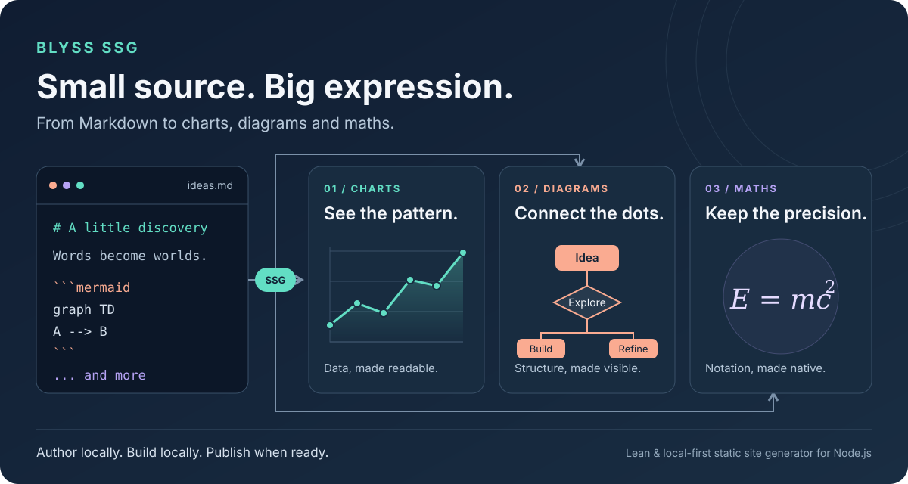

# BLYSS SSG
## SMALL SOURCE. BIG EXPRESSION.
[](https://github.com/Blooniverse/Blyss/commits/main/)
[](https://github.com/Blooniverse/Blyss/actions/workflows/ci-dev-build-test.yml)

Blyss is a lean, local-first SSG (static site generator) for Markdown++. Ships with a dependency-free Node.js server.

↪︎ Build multilingual sites from Markdown++ with math, diagrams and cross-references.
- Technical & scientific: [MyST](https://mystmd.org/) subset!  

↪︎ Secure local control.
- Creative: Authors can co-design the visuals.




## Features

- **Markdown++**: AI & KMS ready for the knowledge management era.
    - **Formulae**: LaTeX in Markdown to MathML in HTML — via [Temml.org](https://temml.org/).
    - **Diagrams**: Extensive charting — via [Flowchart.js](https://flowchart.js.org/), [Mermaid](https://mermaid.js.org/), even [Vega-Lite](https://vega.github.io/vega-lite/).
    - **Callouts & figures**: Admonitions, images and figures as [MyST](https://mystmd.org/) directives, plus GitHub alerts.
    - **Labels, numbers & references**: Numbered figures and formulae, and references that fill in their own text.
    - **Code highlighting**: Supports nearly 200 languages — via [Highlight.js](https://highlightjs.org/).
    - **Task lists**: `- [x]` and `- [ ]` as checkboxes.
    - **Footnotes**: `[^footnote]`
    - **Compatibility**: [Marktext.me](https://marktext.me), [Obsidian.md](https://obsidian.md), etc.
- **Authoring with 3 content types**: book doc, page, post.
    - `draft: true` in Frontmatter.
    - In-browser content editing via: [Decap CMS](https://decapcms.org/) or [Tina](https://tina.io/).
- **Themeable**: Blyss comes with a lean starter.
- **Composable**: Markdown components and their fragments can be used anywhere.
- **Configurable**: Via blyss.config.js and component Markdown.
- **Multilingual**: EN/DE are defaults — they can be extended.
- **AIO & SEO**: Semantic RDF graph (in JSON-LD), plus a classic sitemap.xml.
> [!IMPORTANT]
> - **Cybersecurity**:
>     - 0 (ZERO) dependencies in the Node.js server!
>     - 3 (THREE) dependencies in the SSG engine: `highlight.js`, `marked`, `temml` (nor any further dependencies)!
> - **Local-first**: Full control for devs & authors. Ideal for Git-based workflows.


## Simple local workflow
```text
Authoring (local)
  ▼
Blyss SSG (local)
  ▼
Static website (local)
  ▼
Publishing (optional)
```


## Optional Git & automation workflow
```text
Authoring
  ▼
Git Client (CLI, GUI, CMS)
  ▼
Git Repository
  ├────────────────┐
  ▼                │
Blyss SSG          │
  ▼                │
Website            │
                   ▼
            Automation Platform
        (Activepieces, Windmill, N8n)
```


## Quick start (from scratch)
Requirements: Node.js 24 or newer and npm.
```bash
npx @blooniverse/blyss init my-site   # copy the bundled starter into my-site/
cd my-site
npm install                           # install Blyss into the new website
npm run build                         # generate public/
npm start                             # serve public/ on localhost:3000
```

`blyss init` only copies files. Installing dependencies, building and serving are separate steps.


## Installation

To add Blyss to an existing Blyss website instead, one with a `blyss.config.js`, `_content/`, `templates/`, `components/` and `static/` beside its `package.json`:

```bash
npm install @blooniverse/blyss
```

Then add the scripts `"build": "blyss build"` and `"start": "blyss serve"` to its `package.json`. A new website is best started with `blyss init`, which copies all of these.

> [!WARNING]
> Run the commands through `npm run`, or `npx blyss` inside a website that has Blyss installed. Elsewhere, `npx blyss` runs `blyss`, an unrelated npm package; the full name `npx @blooniverse/blyss` always runs Blyss.


## Development (contributors)

Working on Blyss itself requires Node.js 24 or newer.

```bash
git clone https://github.com/Blooniverse/Blyss.git
cd Blyss
npm ci
npm run build   # render starters/lean/ into public/
npm start       # preview locally at http://localhost:3000
```

- Run `npm test` to rebuild the starter and execute the test suite.
- Run the Bash script `scripts/local-testing-package.sh [path/to/website]` to pack Blyss and 
    1) *Test A*: Build a temporary website with that package – as users get it.
    2) *Test B* (opt): Build a copy of an existing website with that package.
- Treat `public/` as generated output; make changes in the source or starter.


## Documentation

- [Documentation book](starters/lean/_content/en/book/index.md) ([Deutsch](starters/lean/_content/de/book/index.md)): setup, authoring & deployment.
> [!TIP]
> In a built starter, visit `/en/book/` or `/de/book/`.


## License

Blyss and its starter are licensed under the [GNU General Public License v3.0](LICENSE). The starter also ships the stylesheet and the font of [Temml](https://temml.org/) under the [MIT License](starters/lean/static/assets/temml/LICENSE.txt).
