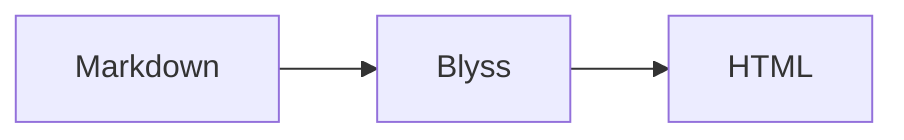

# Authoring content

The URLs follow the files: pages in `_content/<language>/pages/` are published below `/<language>/pages/`, such as `pages/about.md` at `/en/pages/about/`, posts below `/<language>/posts/` and docs below `/<language>/book/`. Only `pages/index.md`, the home page, is published at `/<language>/`, and `pages/404.md` at `/<language>/404.html` (see below). `slug` replaces the file name in the URL.

Keep translations linked with the same `translationKey`.

Titles come from front matter, so Markdown body text should begin below the title rather than with another H1.

A paragraph that consists of `` alone shows the [component](USAGE.md#components) of that name in a page, post or doc, and a fenced code block with `` as its language, a [block](USAGE.md#blocks), shows it with a text and settings of its own.

Posts can have tags, written as `tags: [Blyss, Markdown]`, `tags: Blyss, Markdown` or a YAML block list. Every build also generates:

- `/<language>/posts/`: all posts of the language, newest first;
- `/<language>/tags/`: all tags of the language with their post counts;
- `/<language>/tags/<tag>/`: the posts with that tag;
- `/sitemap.xml`: every page with `lastmod` (from `dateModified` or `datePublished`) and its `hreflang` alternates.

The archive and tag pages show `pagination.pageSize` posts each and continue at `/<language>/posts/page/<n>/` and `/<language>/tags/<tag>/page/<n>/`, linked with `rel="prev"` and `rel="next"`.

Docs, the pages of a book such as a technical documentation, lie in `_content/<language>/book/` and are published below `/<language>/book/`, such as `book/writing/navigation.md` at `/en/book/writing/navigation/`. As in Docusaurus or MkDocs, the directories structure the documentation:

- Each directory is a section, and its `index.md` is the section's start page, whose `title` names the section in the navigation; `book/index.md` is the start page of the whole book. A directory with docs but without `index.md` stops the build with an error.
- `order` in the front matter, a number such as `1` or `2.5`, places a doc or a section among those beside it: lower numbers first, those without an order last, and those with the same order by title.
- Each heading of a doc gets an id from its text, as on GitHub: `## Getting started` becomes `<h2 id="getting-started">`, and the next heading of the same text `getting-started-1`. An id that the templates or the doc's HTML blocks and components already use gets a number, too.
- Docs have the JSON-LD type `TechArticle` and appear in the sitemap, but not in the archive, the tags or `{{recentPosts}}`; they have no tags.

A top-level `pages/404.md` is published at `/<language>/404.html` instead of at its slug. The default language's “not found” page is also published as `/404.html`, which `blyss serve` returns with HTTP status 404 for every missing URL. “Not found” pages are left out of the sitemap; link from them with absolute paths, since they appear at any URL.

Tag URLs use ASCII slugs (`Über Blyss` becomes `/en/tags/uber-blyss/`), and tag pages with the same slug are linked across languages. A tag is displayed as spelled in its newest post. A content file whose URL is already taken by another file or a generated page stops the build with an error.

## Formulas

A formula is LaTeX between dollar signs, which Blyss turns into MathML during the build:

- `$e^{i\pi} + 1 = 0$` is a formula within a text. No space follows its first dollar sign or precedes its second, and no digit follows that one, so that `$5 and $10` stays text. It ends before a code span, whose backtick it cannot contain.
- `$$…$$` on lines of its own is a formula between the paragraphs, on one line or several. Within a text, `$$…$$` shows the formula in the same way.
- `\$` is a dollar sign that starts no formula. In code, a dollar sign is always just that.
- Temml lists the [LaTeX that it supports](https://temml.org/docs/en/supported.html). A formula that is not valid LaTeX stops the build with the name of its file.

Formulas appear in every text, also in those of the components, of the hero and of the overlay.

## Footnotes

`[^name]` refers to a footnote, and `[^name]: Text` on a line of its own defines it, anywhere in the file:

```markdown
Blyss numbers the footnotes[^order].

[^order]: In the order of their first references, whatever their names.

    A further paragraph of a footnote is indented by four spaces.
```

- The footnotes follow the text as a numbered list, each with a link back to each of its references. A footnote without a reference is left out, and a reference without a footnote stays as it is written.
- A name is a word or a number, without spaces.
- Pages, posts and docs have footnotes; the texts of the components, of the hero and of the overlay have none.

## Code

A fenced code block that names its language, such as `js`, `css` or `bash`, is highlighted during the build, in any of the [languages of highlight.js](https://highlightjs.org/demo). A block without a language, or in one that highlight.js does not know, stays plain.

## Diagrams

A fenced code block in the language of a component shows that component instead of the code (see [Code blocks](README_USAGE.md#code-blocks)). The starter has three such components, which draw diagrams in the browser: `mermaid` shows a [Mermaid](https://mermaid.js.org/) diagram, `flowchart` or `flow` a [flowchart.js](https://flowchart.js.org/) flowchart and `vega-lite` a [Vega-Lite](https://vega.github.io/vega-lite/) chart.

````markdown

````

The code is written as these tools expect it, so that other Markdown tools show the same diagram. A [block](README_USAGE.md#blocks) of the component, with `{{componentMermaid}}` as its language, gives one diagram a title and settings of its own in its front matter, followed by the code. Such a code block stands on its own: within a list or a quotation, it stays code.

