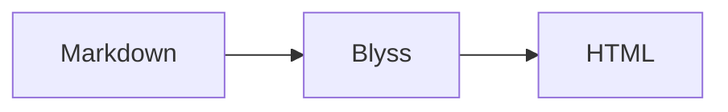

# Usage

## As a CLI

```bash
blyss init [directory]   # create a starter website in a new or empty directory
blyss build              # generate the website into directories.public
blyss serve              # serve the generated website on PORT or server.fallbackPort
```

Inside a website, run these commands with `npx blyss <command>` or through npm scripts, from the root directory where `blyss.config.js` lives. Without that file, `build` and `serve` stop and suggest `blyss init`. Websites created by `blyss init` already have these scripts in `package.json`:

```json
{
  "scripts": {
    "build": "blyss build",
    "start": "blyss serve"
  }
}
```

## blyss init

`blyss init [directory]` copies the bundled lean starter into `directory`, or into the current directory without an argument.

- A missing directory is created; an existing one must be empty. A non-empty directory is refused and left untouched: Blyss never overwrites files and has no `--force` option.
- If copying fails, Blyss removes only the files and directories it created.
- The new `package.json` is named after the directory and depends on the running Blyss version (`^x.y.z`).
- It does not run `npm install`, initialize Git, build, serve or use the network.

The **bundled starter** in `starters/lean/` is never modified. The **generated website** is your own copy: edit it freely. Its **build output** (`public/`) is recreated by every build and must not be edited manually.

## Site structure

A website created by `blyss init` looks like this:

```text
my-site/
├── .gitignore
├── *.md
├── blyss.config.js
├── package.json
├── _content/
├── components/
├── templates/
├── static/
|
└── public/  # generated by blyss build
```

## blyss.config.js

```js
export default {
  site: { 
    defaultLanguage: "en",
    languages: {
    ...
    }
  },
  hero: {
    components: { componentSliderHero: true, componentGalleryHero: true, componentFlowerHero: true },
    ...
  },
  overlay: {
    showOn: { page: true, post: true, book: true, home: false, list: true, "not-found": true },
    ...
  },
  components: {
  ...
  },
  directories: {
    public: "public",
    ...
  },
  server: { fallbackPort: 3000 },
};
```

`site.languages` lists any number of languages, in the order of the language switcher and of the `hreflang` alternates. The key of a language, such as `en` or `pt-br`, names its directory in `_content/` and starts its URLs, so it may contain only lower-case Latin letters, digits and hyphens. Each language needs a `label` for the language switcher and a `locale` such as `"en"` or `"en-GB"`; its `description` serves pages without one of their own. All languages need the same `labels`; those of what Blyss generates (`language`, `recentPosts`, `posts`, `tags`, `tag`, `page`, `pagination`, `newerPosts`, `olderPosts`, `book`, `onThisPage`, `previous`, `next`, `footnotes` and `backToText`) default to English. `site.defaultLanguage` is the language that `/` redirects to and whose “not found” page is also published as `/404.html`; it defaults to the first language. `site.languageSwitcher` defaults to `true`; `false` leaves `{{languageSwitcher}}` empty but keeps the `hreflang` alternates. Blyss refuses other values, and content outside the languages' directories, before it deletes the previous output.

All directories are resolved relative to the website's root. `directories.public` is the output directory, which every build deletes and recreates. It must be a subdirectory of the root that neither contains nor lies inside `components`, `content`, `static` or `templates`; other values, such as `"."`, are refused without deleting anything. The starter names the content directory `_content`, and components are published below `/components/`; without a components directory, a website has no components. `pagination.pageSize` defaults to 10 and must be a whole number greater than 0.

`layout.margin` defaults to `"2vmin"`, and `layout.paddingHero` and `layout.paddingOverlay` to `"1rem"`; all must be CSS lengths in `px`, `rem`, `vw`, `vh`, `vmin` or `vmax`. The alignments apply to the home pages, all other pages, the hero and the overlay: `layout.alignHome` is `"center"` (the default) or `"left"`, `layout.alignOther` is `"left"` (the default), `"center"` or `"centerLeft"`, and `layout.alignHero` and `layout.alignOverlay` are `"centerExtra"` (the default), `"left"` or `"center"`; the templates' stylesheet defines what each value looks like. Other values are refused before the previous output is deleted.

`hero` and `overlay` set the parts of the two [regions](#hero-and-overlay) that accompany the pages, the hero of the home pages and the overlay:

- `hero.components` and `overlay.components` list the [components](#components) of each region by name, in order of appearance, usually the region's [variants](#variants), such as `componentSliderHero` in the hero and `componentSliderOverlay` in the overlay. Each is switched on with `true` or off with `false`; an unlisted component does not appear.
- `hero.texts` and `overlay.texts` show (`true`, the default) or hide (`false`) the region's texts, those of `_content/<language>/heroTexts.md` or `overlayTexts.md`.
- `overlay.showOn` switches the overlay on or off for each kind of page: `page`, `post` and `book`, the three content types, and `home`, `list` and `"not-found"`. An unnamed kind has the overlay; a single page or post cannot be switched. The hero belongs to the home pages only.
- `synchroniseHeroOverlay: true` (default `false`) makes the overlay a copy of the hero: it shows `hero.components`, with their settings and texts, and, if `hero.texts` is `true`, the texts of `heroTexts.md`, whatever `overlay.components`, `overlay.texts` and `overlayTexts.md` say. `overlay.showOn` still applies.

A region without a part that is switched on is not shown. Blyss refuses switches that are not `true` or `false`, unknown components and unknown kinds of pages before it deletes the previous output.

`components` holds the settings of each [component](#components) and [variant](#variants) under its name; the component defines them, and the starter's README describes those of its slider, gallery and flower. Settings for a nonexistent component or variant are refused, too.

## Templates

Blyss ships no default templates; customise the ones `blyss init` copies into `templates/`. Blyss renders each page into a content template, then the result into `document.html`:

| Template | Placeholders |
| --- | --- |
| `home.html` (optional, for `/<language>/`), `page.html`, `post.html` | `{{title}}`, `{{description}}`, `{{dateBlock}}`, `{{tags}}` (a post's tag links), `{{content}}` (the Markdown body), `` (a component) |
| `book.html` (optional, for docs) | The same, and `{{bookNavigation}}`, `{{bookToc}}`, `{{bookPager}}` (see [AUTHORING.md](AUTHORING.md)) |
| `document.html` | `{{content}}`, `{{hero}}`, `{{overlay}}`, `{{pageTitle}}`, `{{description}}`, `{{locale}}`, `{{languageKey}}`, `{{canonicalUrl}}`, `{{alternateLinks}}`, `{{jsonLd}}`, `{{languageSwitcher}}`, `{{kind}}`, `{{layoutMargin}}`, `{{layoutPaddingHero}}`, `{{layoutPaddingOverlay}}`, `{{layoutAlign}}`, `{{layoutAlignHero}}`, `{{layoutAlignOverlay}}`, `{{<key>Label}}`, `{{<name>Title}}`, `{{<name>Content}}`, `` (a component) |
| `hero.html`, `overlay.html` (both optional) | `{{components}}`, `{{textsTitle}}`, `{{texts}}` (see [Hero and overlay](#hero-and-overlay)), and those of `document.html` but `{{hero}}` and `{{overlay}}` |

- Without `home.html` or `book.html`, the home pages or the docs use `page.html`.
- `{{kind}}` is `home`, `page`, `post`, `book`, `list` (archive and tag pages) or `not-found`, for styles such as `<body data-kind="{{kind}}">`.
- `{{bookNavigation}}` lists all docs of the language as nested lists in a `<nav>`, the current doc marked with `aria-current="page"`. `{{bookToc}}` links to the doc's `##` headings, each with its `###` headings. `{{bookPager}}` links to the previous and next doc with `rel="prev"` and `rel="next"`. All three are empty on other pages and take precedence over components of the same name.
- Each Markdown file directly in `_content/<language>/`, such as `heroTexts.md`, is a fragment: Blyss publishes no page for it, but `document.html` shows it on every page of that language as `{{<name>Title}}`, its front matter's `title`, and `{{<name>Content}}`, its Markdown as HTML, such as `{{heroTextsTitle}}` and `{{heroTextsContent}}`. Its name must start with a Latin letter and contain only Latin letters and digits. Without the file, both are empty; the other placeholders of `document.html`, such as `{{pageTitle}}`, take precedence.
- `{{hero}}` and `{{overlay}}` show the page's hero and overlay, rendered by `hero.html` and `overlay.html`; they are empty on a page without them (see [Hero and overlay](#hero-and-overlay)).
- `{{layoutMargin}}`, `{{layoutPaddingHero}}` and `{{layoutPaddingOverlay}}` are `layout.margin`, `layout.paddingHero` and `layout.paddingOverlay`. `{{layoutAlign}}` is `layout.alignHome` on the home pages and `layout.alignOther` elsewhere; `{{layoutAlignHero}}` and `{{layoutAlignOverlay}}` are `layout.alignHero` and `layout.alignOverlay`. For example: `<body data-align="{{layoutAlign}}" data-align-hero="{{layoutAlignHero}}" data-align-overlay="{{layoutAlignOverlay}}" style="--site-margin: {{layoutMargin}}; --hero-padding: {{layoutPaddingHero}}; --overlay-padding: {{layoutPaddingOverlay}}">`.
- `` shows the [component](#components) or [variant](#variants) of that name, such as `{{componentSlider}}` or `{{componentSliderHero}}`. The other placeholders of a template take precedence.
- `{{languageSwitcher}}` links the page to its translations in the order of `site.languages`; it is empty if `site.languageSwitcher` is `false`.
- Every label of the language is available as `{{<key>Label}}`, such as `{{postsLabel}}` for `labels.posts`; those of what Blyss generates default to English.

## Formulas, footnotes and code

Blyss reads every Markdown text with [marked](https://marked.js.org/) and adds formulas, highlighted code and footnotes during the build; [AUTHORING](README_AUTHORING.md#formulas) describes how to write them. The stylesheet of a website gives their HTML its look:

| Markdown | HTML | Stylesheet |
| --- | --- | --- |
| `$…$` within a text | `<math>…</math>`, MathML from [Temml](https://temml.org/) | Temml's stylesheet with its font, such as `Temml-Local.css` and `Temml.woff2` from its `dist/` directory, which lays out the MathML |
| `$$…$$` on lines of its own | `<div class="math"><math display="block" class="tml-display">…</math></div>` | The same; `.math` for the space around the formula and for scrolling a wide one |
| A fenced code block in a language that [highlight.js](https://highlightjs.org/) knows | `<pre><code class="language-js">` with a `<span class="hljs-keyword">` and so on for each part | The colours of the `hljs-…` classes; without them, the code is plain |
| `[^name]` | `<sup class="footnote-ref"><a href="#fn:1" id="fnref:1" role="doc-noteref">1</a></sup>`; a second reference to the same footnote has the id `fnref:1:2` | `.footnote-ref` |
| `[^name]: Text` | `<section class="footnotes" role="doc-endnotes" aria-label="…"><ol><li id="fn:1">…</li></ol></section>` after the text, each footnote ending with a link back to each of its references, `<a href="#fnref:1" role="doc-backlink" aria-label="…">` | `.footnotes` |

- Formulas and highlighted code appear in every Markdown text: in pages, posts and docs, in the texts of components, in fragments and in the texts of the hero and the overlay. Footnotes belong to the text of a page, a post or a doc.
- Formulas are MathML, which browsers show without a script. The MathML and the stylesheet come from the same version of Temml: Blyss depends on one exact version, and the starter ships that version's stylesheet and font in `static/assets/temml/`.
- A formula that is not valid LaTeX stops the build with the name of its file, before the previous output is deleted.
- The labels `footnotes` and `backToText` name the list of footnotes and the links back for screen readers.
- Code in a language that highlight.js does not know, or without a language, is escaped as it is.

## Regions: Hero and Overlay

The Hero and the Overlay are two independent regions that accompany the pages, each with a template, components and texts of its own:

| | Hero | Overlay |
| --- | --- | --- |
| Appears on | the home pages | the kinds of pages that `overlay.showOn` does not switch off |
| Template, shown in `document.html` | `hero.html` as `{{hero}}` | `overlay.html` as `{{overlay}}` |
| Components | `hero.components`, usually `<name>Hero` [variants](#variants) | `overlay.components`, usually `<name>Overlay` variants |
| Texts | `_content/<language>/heroTexts.md`, if `hero.texts` is `true` | `_content/<language>/overlayTexts.md`, if `overlay.texts` is `true` |

A region's template has three placeholders of its own, besides those of `document.html`:

- `{{components}}`: the components of the region that are switched on, one after the other in the order of its settings.
- `{{textsTitle}}`: the `title` of the front matter of its texts.
- `{{texts}}`: its texts. Each `###` heading starts a text that runs up to the next one; each text is a `<div>` that starts with its heading as `<h3>`. Only whitespace and HTML comments may precede the first `###` heading.

A region is left out, and its placeholder is empty, on a page it does not belong to, without its template, and without content: no component switched on and no texts, because they are switched off or the language lacks the file. With `synchroniseHeroOverlay: true`, the overlay takes its components and texts from the hero.

## Components

A component is a self-contained part of a page, such as the starter's slider, gallery and flower: a directory in `components/` named like the component, holding its template and, optionally, its stylesheet and script.

| File or setting | Purpose |
| --- | --- |
| `components/<name>/<name>.html` | The template: the only file that a component needs. |
| `components/<name>/<name>.data.js` | Optional: checks the settings and prepares further values for the template; names the languages of the [code blocks](#code-blocks) that the component shows. |
| Every other file in `components/<name>/`, such as `<name>.css` and `<name>.js` | Published at `/components/<name>/`. The template links to its stylesheet and its script itself. |
| `_content/<language>/components/<name>.md` | Optional: the texts in that language. |
| `components.<name>` in `blyss.config.js` | Optional: the settings. |

`` shows the component in every template and, in a paragraph of its own, in the Markdown of a page or post; in code, the placeholder stays as it is. A [block](#blocks) shows it with a text and settings of its own, and `hero.components` and `overlay.components` show it in the [hero and overlay](#hero-and-overlay). A component can appear several times on a page. Its name must start with a Latin letter and contain only Latin letters and digits.

The template has the following placeholders. Each replaces an earlier one of the same name:

- `{{<key>Label}}`: every label of the page's language.
- ``: every setting that is a text, a number or a truth value.
- `` and `{{content}}`: every field of the front matter of the component's text, such as `{{title}}`, and the Markdown below it as HTML. Without the file, they are empty.
- The values that the data file returns.
- `{{id}}`: `<name>-1` where the component first appears on a page, then `<name>-2` and so on, for ids that must be unique.

Blyss escapes labels, settings and front matter for HTML and inserts the data file's values as they are. The data file exports one function, called for every language and every block before the previous output is deleted:

```js
export default function ({ settings, languageKey, content, texts, source, frontMatter, escapeHtml, refuse }) {
  const { columns = 2 } = settings; // components.<name> in blyss.config.js, or {}
  if (!Number.isInteger(columns)) throw refuse("columns", columns, "a whole number");
  return { columns, language: `<p>${escapeHtml(languageKey)}</p>` }; // {{columns}} and {{language}}
}
```

`content` is the component's text as HTML. `texts` holds the texts that its `###` headings start, each as HTML up to the next heading, for components such as the starter's flower; it is empty without such headings. `source` is the text as it is written. `frontMatter` holds the text's front matter fields as written. `refuse(setting, value, requirement)` creates the error that stops the build with “Cannot use components.\<name>.columns 2.5: it must be a whole number.”

### Variants

Every component has a variant for each region: `<name>Hero` for the hero and `<name>Overlay` for the overlay, such as `componentSliderHero` and `componentSliderOverlay`. A variant is the component under another name, with a text and settings of its own, so that the hero and the overlay can show the same component differently:

| File or setting | Purpose |
| --- | --- |
| `_content/<language>/components/<name>Hero.md`, `<name>Overlay.md` | Optional: the variant's texts in that language. |
| `components.<name>Hero`, `components.<name>Overlay` in `blyss.config.js` | Optional: the variant's settings. |

A variant takes nothing from the component's own text and settings, and shares only its template, data file, stylesheet and script, published once at `/components/<name>/`. Everything else on this page holds for a variant under its own name: `{{componentSliderHero}}` shows the hero's slider in a template or in the Markdown of a page, a block of it gives it a text and settings of its own, its `{{id}}` is `componentSliderHero-1` and so on, and the data file's errors name `components.componentSliderHero`. A variant without settings in `blyss.config.js` may lack settings that its data file requires: that error stops only a build that shows the variant without a block that sets them. `hero.components` and `overlay.components` accept components and variants alike. Blyss refuses a component directory named like the variant of another, such as `components/componentSliderHero/`.

### Blocks

In the Markdown of a page, post or doc, a fenced code block with `` as its language is a block of that component: it shows the component with a text and settings of its own, in that one place.

````markdown
```{{componentFlower}}
---
title: Five petals
petals: 5
---

### The first petal

Its text.
```
````

A block holds what the component's text holds, front matter and Markdown, and both are optional:

- Its front matter adds to the front matter of `_content/<language>/components/<name>.md` and replaces the fields of the same name.
- Each of its fields also sets the setting of its name, in place of `components.<name>` in `blyss.config.js`. A value that is JSON, such as `5`, `true`, `"5"` or `[1, 2]`, is taken as such, and any other value as a text.
- Its Markdown replaces that of the component's text. A block without Markdown keeps it, so that a block of front matter alone changes fields and settings only, and an empty block is the component as it is.

The template and data file serve blocks unchanged, receiving the block's fields, settings and text as they receive the component's. If the data file refuses a setting of a block, the build stops with “Cannot build _content/en/pages/about.md: its {{\<name>}} block cannot use columns 2.5, which must be a whole number.” A block whose text contains a fenced code block needs a longer fence, such as four backticks. A block that names no component stays a code block, and so does one within a list or a quotation: a block stands on its own.

### Code blocks

A component can show the fenced code blocks of a language, as the starter's `componentMermaid` shows those in `mermaid` as diagrams. Its data file names its languages:

```js
export const languages = ["mermaid"];
```

````markdown

````

- A code block in one of these languages is a block of the component with the code as its text. The code is taken as it is, without front matter, so that it stays what other Markdown tools expect; the language is the first word after the fence.
- Such a component takes code instead of Markdown wherever its text comes from, a code block, a `` block or its text file: `{{content}}` is the code, escaped for HTML, `source` is the code as it is written, and `texts` is empty.
- A `` block gives one instance fields and settings of its own, as for every component: its front matter holds them, and the code follows it.
- The code block shows the component itself, with `components.<name>` and `_content/<language>/components/<name>.md`; its variants appear where their names put them.
- Each language belongs to one component: the build stops if two components name the same one, or if `languages` is not a list of words. As with every block, such a code block within a list or a quotation stays code.

## Commands

```bash
npm run build   # build into directories.public
npm start       # serve it on http://localhost:3000
```

## Hosting

Before deploying, set `site.baseUrl`, the publisher data and the language details in `blyss.config.js`, and the `Sitemap:` URL in `static/robots.txt`.

Blyss does not generate `public/index.html`: configure your host to redirect `/` to the default language and to answer missing URLs with `/404.html`, as `blyss serve` does.

Websites created by `blyss init` include `static/staticwebapp.config.json`, which configures both for Azure Static Web Apps. Azure's build service may lack Node.js 25 or newer, so their README shows a GitHub Actions workflow that builds the website and uploads `public/` with `skip_app_build: true`; it adds an `index.html` stub, which Azure requires and the `/` redirect hides.

## Developing Blyss

This repository contains the engine (`bin/`, `src/`), the bundled starter (`starters/lean/`) and the tests (`test/`), but no website. Its `blyss.config.js` previews the starter in place:

```bash
npm install     # install the engine's dependencies; nothing is scaffolded
npm run build   # render starters/lean/ into public/ (git-ignored)
npm start       # serve public/ on http://localhost:3000
npm test        # build, then run the test suite
```

Website content, static assets, templates and components belong in `starters/lean/`, from where `blyss init` copies them into new websites.

Blyss has three dependencies, none with dependencies of its own: `marked` reads Markdown, `temml` turns formulas into MathML and `highlight.js` highlights code. `src/build/markdown.js` alone uses them. `marked` is at least 16.4.2, the version Blyss is tested with: versions before 16.3.0 lack the hook that keeps the `*` and `_` of a formula out of an emphasis, and stop every command. `temml` is set to one exact version, because the starter ships that version's stylesheet and font in `starters/lean/static/assets/temml/`; after changing the version, copy `Temml-Local.css` and `Temml.woff2` from `node_modules/temml/dist/` there again, which a test checks.

## Acknowledgments

Blyss was initially developed with assistance from Microsoft 365 Copilot in August 2026. After the Github repository creation, Blyss has been being co-developed by Blooniverse and Github Copilot.
