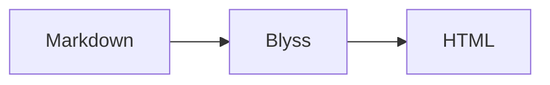

# My Website

A bilingual (English and German) website generated with [Blyss](https://github.com/Blooniverse/Blyss).

## Workflow

```bash
npm install     # install Blyss
npm run build   # generate the website into public/
npm start       # serve public/ on http://localhost:3000
```

## Structure

| Path | Purpose |
| --- | --- |
| `_content/en/pages/`, `_content/en/posts/`, `_content/en/book/` | English Markdown pages, posts and docs |
| `_content/de/pages/`, `_content/de/posts/`, `_content/de/book/` | German Markdown pages, posts and docs |
| `_content/en/heroTexts.md` and `_content/de/heroTexts.md` | The texts of the [hero](#hero) |
| `_content/en/overlayTexts.md` and `_content/de/overlayTexts.md` | The texts of the [overlay](#overlay) |
| `_content/en/components/`, `_content/de/components/` | The texts of the components' [variants](#variants) for the hero and the overlay, and those of the [diagrams](#diagrams) |
| `components/` | The [components](#components) `componentSlider/`, `componentGallery/` and `componentFlower/`, and the [diagrams](#diagrams) `componentMermaid/`, `componentFlowchart/` and `componentVegaLite/`, each with its template, stylesheet and script |
| `templates/` | HTML templates: `document.html`, `home.html`, `page.html`, `post.html`, `book.html`, `hero.html`, `overlay.html` |
| `static/` | Static files such as `static/assets/css/main.css`, `static/assets/img/logo.svg`, the gallery's images in `static/assets/img/gallery/`, the stylesheet and the font of the [formulas](#formulas) in `static/assets/temml/`, `static/robots.txt` and `static/staticwebapp.config.json`, copied unchanged into `public/` |
| `blyss.config.js` | Commented site, language, pagination, layout, hero, overlay, component, directory and server configuration |
| `public/` | Generated website — do not edit |

## Code

A fenced code block that names its language, such as `js`, is highlighted during the build, in any language that [highlight.js](https://highlightjs.org/demo) knows; other code stays plain. The highlighted parts have classes such as `hljs-keyword` and `hljs-string`, which `static/assets/css/main.css` colours in its block for highlighted code. Each of these colours has a contrast of at least 4.5 to 1 on the background of code; keep that if you change them.

## Formulas

A formula is LaTeX between dollar signs. Blyss turns it into MathML during the build, which browsers show without a script.

- `$e^{i\pi} + 1 = 0$` is a formula within a text. No space follows its first dollar sign or precedes its second, and no digit follows that one, so that prices such as `$5 and $10` stay text.
- `$$…$$` on lines of its own is a formula between the paragraphs, on one line or several.
- `\$` is a dollar sign that starts no formula; within code, dollar signs need nothing.
- The build stops and names the file if a formula is not valid LaTeX; [Temml](https://temml.org/docs/en/supported.html), which Blyss uses, lists what it supports.
- `templates/document.html` loads Temml's stylesheet, `static/assets/temml/Temml-Local.css`, which lays the formulas out with the font beside it; `LICENSE.txt` there is Temml's licence. Both belong to the version of Temml that your version of Blyss uses: after an update of Blyss, replace them with `Temml-Local.css` and `Temml.woff2` from `node_modules/temml/dist/` if the changelog says so. [Fonts](#fonts) tells which fonts the formulas use.
- `.math` in `static/assets/css/main.css` sets the space around a formula on lines of its own and lets a wide one scroll sideways.

## Diagrams

Three components show the fenced code blocks of their languages as diagrams. The code is written as their libraries expect it, so that other Markdown tools show the same diagrams:

| Language of the code block | Component | Shows |
| --- | --- | --- |
| `mermaid` | `componentMermaid` | A [Mermaid](https://mermaid.js.org/) diagram: a flowchart, a sequence, a Gantt chart and many more |
| `flowchart` or `flow` | `componentFlowchart` | A [flowchart.js](https://flowchart.js.org/) flowchart |
| `vega-lite` | `componentVegaLite` | A [Vega-Lite](https://vega.github.io/vega-lite/) chart from its specification in JSON |

````markdown

````

- The browser draws a diagram once it comes near the window, or once an overlay that holds it opens, and loads its library only then; pages without diagrams load none. Until a diagram is drawn, and without JavaScript, its code is shown. If the library cannot be loaded or cannot read the code, the code stays below a message, the `error` of the component's text.
- A code block shows the diagram as it is. A [block](#blocks) with the component's name in double curly braces as its language gives one diagram a `title`, shown below it, and settings of its own in its front matter, followed by the code:

  ````markdown
  ```{{componentMermaid}}
  ---
  title: From Markdown to HTML
  theme: forest
  ---

  flowchart LR
    Markdown --> Blyss --> HTML
  ```
  ````

- `_content/<language>/components/componentMermaid.md`, `componentFlowchart.md` and `componentVegaLite.md` hold the texts of the diagrams in each language: `error`, the message above code that cannot be drawn, and for the flowcharts `yes` and `no`, the texts at the two ways out of a condition.
- The diagram settings and their defaults are explained in `blyss.config.js`. Diagrams inherit the surrounding font; flowchart colour is set in `components/componentFlowchart/componentFlowchart.css`. A Vega-Lite chart has no background unless its specification sets one; `"width": "container"` makes it as wide as the text. The build stops if its code is not JSON.
- Like every component, each has a variant for the hero and one for the overlay, such as `componentMermaidHero` with its code in `_content/<language>/components/componentMermaidHero.md`, below the front matter.
- Each URL starts with `https://` or, for a file in `static/`, with `/`. To show the code blocks of another language, name it in `languages` in the component's data file, such as `components/componentMermaid/componentMermaid.data.js`.

### Hosting the libraries yourself

By default, the browser loads the libraries from [jsDelivr](https://www.jsdelivr.com/), a content delivery network: a visit to a page with a diagram sends the visitor's IP address there, as [the font](#fonts) sends it to Google. To avoid that, copy the libraries into `static/` and set their URLs in `blyss.config.js`:

| Setting | Files | Source | Example of the setting |
| --- | --- | --- | --- |
| `componentMermaid.library` | `dist/mermaid.esm.min.mjs` and, beside it, the `.mjs` files of `dist/chunks/mermaid.esm.min/` in `chunks/mermaid.esm.min/` | npm package `mermaid@12.3.0` | `"/assets/mermaid/mermaid.esm.min.mjs"` |
| `componentFlowchart.libraryRaphael` | `raphael.min.js` | npm package `raphael@2.3.0` | `"/assets/flowchart/raphael.min.js"` |
| `componentFlowchart.libraryFlowchart` | `release/flowchart.min.js` | [flowchart.js on GitHub](https://github.com/adrai/flowchart.js/tree/v1.18.1/release), tag `v1.18.1` | `"/assets/flowchart/flowchart.min.js"` |
| `componentVegaLite.libraryVega` | `build/vega.min.js` | npm package `vega@6.4.0` | `"/assets/vega/vega.min.js"` |
| `componentVegaLite.libraryVegaLite` | `build/vega-lite.min.js` | npm package `vega-lite@6.5.0` | `"/assets/vega/vega-lite.min.js"` |

`npm pack mermaid@12.3.0` downloads a package as a `.tgz` archive without installing it; unpack it and copy the files. Mermaid loads only the parts that a diagram needs from its `chunks/` directory, about 5 MB in all. Keep the versions of Vega and Vega-Lite, and those of Raphaël and flowchart.js, in step when you update them.

## Footnotes

`[^name]` refers to a footnote, and `[^name]: Text` on a line of its own defines it, anywhere in the file. A further line or paragraph of a footnote is indented by four spaces.

- Blyss numbers the footnotes in the order of their first references and lists them below the text, each with a link back to each reference. A footnote that nothing refers to is left out.
- Pages, posts and docs have footnotes; the texts of the components, of the hero and of the overlay have none.
- The labels `footnotes` and `backToText` in `blyss.config.js` name the list and the links back for screen readers, and `.footnotes` and `.footnote-ref` in `static/assets/css/main.css` style them.

## Content

Every Markdown file starts with front matter:

```markdown
---
title: Hello World
slug: hello-world
description: The first post of this website.
datePublished: 2026-11-10
translationKey: hello-world
tags: [Blyss, Markdown]
---
```

- Pages in `_content/<language>/pages/` are published at `/<language>/pages/<slug>/`, so that the URLs follow the files; only `index.md`, the home page, becomes `/<language>/`.
- The home pages `/<language>/` use `templates/home.html`: the `title` and `description` of `index.md` become the heading and the slogan in their header.
- Posts in `_content/<language>/posts/` are published at `/<language>/posts/<slug>/`.
- Docs in `_content/<language>/book/` are published below `/<language>/book/` (see [Documentation](#documentation)).
- `slug` defaults to the file name. Give each language its own slug for localized URLs.
- Translations are associated by giving them the same `translationKey`. Blyss links them in the language switcher and with `hreflang` alternate links.
- A page containing `{{recentPosts}}` lists the three newest posts of its language, ordered by `datePublished`.
- A paragraph that consists of the name of a component or a [variant](#variants) in double curly braces alone, such as `{{componentSliderHero}}`, shows that [component](#components) in a page, post or doc. A fenced code block with that placeholder as its language, a [block](#blocks), shows it with a text and settings of its own.
- [Formulas](#formulas) stand between dollar signs, [footnotes](#footnotes) have a name after a caret in square brackets, fenced [code](#code) is highlighted, and a code block in `mermaid`, `flowchart` or `vega-lite` shows a [diagram](#diagrams). The doc “Formulas, footnotes, code and diagrams” shows each of them.
- Posts can have `tags`. Blyss generates the archive `/<language>/posts/`, the tag index `/<language>/tags/` and one page per tag, such as `/en/tags/markdown/`. Do not create content at these URLs.
- The archive and tag pages show `pagination.pageSize` posts (10 by default, set in `blyss.config.js`). Older posts continue on `/<language>/posts/page/2/`, `/<language>/tags/<tag>/page/2/` and so on, linked by “Newer posts” and “Older posts”.
- Markdown files directly in `_content/<language>/`, such as `heroTexts.md`, are fragments: Blyss publishes no page for them, but `templates/document.html` can show them on every page of their language as `{{<name>Title}}`, the `title` of their front matter, and `{{<name>Content}}`, their text, such as `{{heroTextsTitle}}` and `{{heroTextsContent}}`. Their file names must start with a Latin letter and contain only Latin letters and digits. `heroTexts.md` and `overlayTexts.md` also hold the texts of the [hero](#hero) and of the [overlay](#overlay).
- `pages/404.md` is the “not found” page. It is published at `/<language>/404.html`; the [default language](#languages)'s page, English, is also published as `/404.html`, which `npm start` and most static hosts show for every missing URL. Because it appears at any URL, link from it with absolute paths such as `/en/`.
- Keep `index.md` and `about.md` in every language without a different slug, and `book/index.md`: the navigation in `templates/document.html` links to `/<language>/`, `/<language>/pages/about/` and `/<language>/book/`.

## Documentation

`_content/<language>/book/` holds a book, here the technical documentation, which the navigation's link “Documentation” opens. The starter's docs explain how it works, in English and in German; replace them with your own.

- Each Markdown file is a doc, such as `_content/en/book/getting-started.md` at `/en/book/getting-started/`. Docs have the front matter of pages, and `order`.
- Each directory is a section, such as `_content/en/book/writing/` at `/en/book/writing/`. Its `index.md` is the start page of the section, and its `title` names the section in the navigation. `_content/<language>/book/index.md` is the start page of the whole documentation. The build stops if a directory with docs lacks its `index.md`.
- `order` places a doc or a section among those beside it: lower numbers first, such as `1`, `2` or `2.5`, those without an order last, and those with the same order by title.
- `templates/book.html` shows the navigation of all docs, the doc's title, a table of contents of its second- and third-level headings, its text, and links to the previous and the next doc in the navigation. The navigation stands beside the doc on wide screens and above it otherwise; `static/assets/css/main.css` styles all of this in its block for docs. Without `templates/book.html`, docs use `templates/page.html`, without navigation, table of contents and links.
- Each heading of a doc gets an id from its text, as on GitHub, so that a link to `#front-matter` leads to the heading “Front matter”.
- The labels `book`, `onThisPage`, `previous` and `next` in `blyss.config.js` name the navigation, the table of contents and the links to the previous and the next doc.
- Docs are described as `TechArticle` in their JSON-LD and listed in `sitemap.xml`, but neither in the archive nor on the tag pages.

## Layout

`layout` in `blyss.config.js` explains the spacing and alignment settings for home pages, other pages, the [hero](#hero) and the [overlay](#overlay). The top bar spans the side margins; the footer lines up with the content.

Centered lists keep their markers next to their items, and code blocks stay left-aligned. `templates/document.html` passes the margin, the paddings and the alignments to `static/assets/css/main.css` through `<body data-align="…" data-align-hero="…" data-align-overlay="…" style="--site-margin: …; --hero-padding: …; --overlay-padding: …">`.

## Top bar

`templates/document.html` starts every page with a bar that stays at the top of the window while the page scrolls. It holds the logo, the navigation, a search field and the language switcher.

- `static/assets/img/logo.svg` is a placeholder logo in the stylesheet's dark blue, `#005180`. Replace it with your own, and adjust the `alt`, `width` and `height` of its `` in `templates/document.html`.
- The search field has no function yet: it belongs to no form, so nothing is sent. The label `search` in `blyss.config.js` holds its text.
- The language switcher links each page to its translations; `site.languageSwitcher: false` hides it (see [Languages](#languages)).
- On narrow screens, the bar wraps into two or three rows.

## Hero

The home pages end with the hero: `{{hero}}` in `templates/document.html` shows `templates/hero.html` below the page, which starts with the site's title and slogan. The commented `hero` settings in `blyss.config.js` switch its parts on or off and set their order.

- Add a component of your own by the name of its [variant](#variants), `<name>Hero`.
- The `title` of `_content/<language>/heroTexts.md` is the texts' heading; each `###` heading starts a text that runs up to the next one. They appear in full, side by side in as many columns as fit. Blyss refuses content before the first `###` heading, except comments.
- A hero without a part that is switched on is not shown at all, and neither is a hero whose only part, its texts, has no file in the page's language. Without `templates/hero.html`, the website has no hero.
- On screens of at least 1024×640 pixels, the page stops below the top bar, or once its end is in view if it is taller than the window, while the hero slides up over it and fades it out. A hero that is shorter than the window then stops below the top bar, and the footer follows it into the window. Keyboard focus in the page turns this effect off, so that the hero never covers the focused element. With reduced motion, on smaller screens and in browsers without scroll-driven animations, the hero is a static block below the page.
- The hero is as tall as its content. `layout.paddingHero` sets the space above and below that content and `layout.alignHero` its alignment (see [Layout](#layout)).
- The label `hero` in `blyss.config.js` names the hero for screen readers.

## Overlay

The overlay is a bar at the bottom of the window: `{{overlay}}` in `templates/document.html` shows `templates/overlay.html`. Its button opens the overlay as a panel; the Close button, the Escape key or a click outside closes it again. The browser's [Popover API](https://developer.mozilla.org/docs/Web/API/Popover_API) does this without JavaScript. The commented `overlay` settings in `blyss.config.js` configure it independently of the hero:

- `showOn` applies to kinds of pages, not to an individual page or post. A kind that it does not name has the overlay.
- `components` and `texts` work like those of the hero, using the overlay's variants and `_content/<language>/overlayTexts.md`, a file like `heroTexts.md`.
- An overlay without a part that is switched on is not shown, and neither is its bar. Without `templates/overlay.html`, the website has no overlay.
- `layout.paddingOverlay` sets the space above and below the content of the opened overlay and `layout.alignOverlay` its alignment (see [Layout](#layout)).
- The labels `overlay` and `close` in `blyss.config.js` hold the texts of the overlay's buttons. Templates can use every label as `{{<key>Label}}`, such as `{{overlayLabel}}`.
- All headings in the hero and in the overlay are `<h3>`: the title of their texts, the headings of their components and the headings of the texts. As they accompany the pages, their headings rank below each page's own `<h1>` and `<h2>`.
- `templates/document.html` sets `<body data-kind="…">` to `home`, `page`, `post`, `book`, `list` or `not-found`, the kinds of pages that `showOn` names; `static/assets/css/main.css` can style each kind with it.

### Synchronising the hero and the overlay

See `synchroniseHeroOverlay` in `blyss.config.js`. `overlay.showOn` still decides which kinds of pages have the overlay, and `layout.paddingOverlay` and `layout.alignOverlay` how it looks.

## Fonts

`templates/document.html` loads the font Titillium Web from Google Fonts. Each visit then sends the visitor's IP address to Google, which a German court held to violate the GDPR without consent (Landgericht München I, 3 O 17493/20, 20 January 2022). To host the font yourself, download it from [Google Fonts](https://fonts.google.com/specimen/Titillium+Web), put the `.woff2` files into `static/assets/fonts/`, declare them with `@font-face` in `static/assets/css/main.css` and remove the three Google Fonts `<link>` elements.

[Formulas](#formulas) load nothing from other servers. `static/assets/temml/Temml-Local.css` asks for a mathematical font of the visitor's system: Cambria Math, which Windows has, STIX Two Math, which Apple's systems have, or Noto Sans Math, and otherwise the browser's own choice, so formulas look plainer on a system without such a font. `Temml.woff2` beside it only holds the script capitals and the primes. For the same look everywhere, Temml's `dist/` directory has further stylesheets, such as `Temml-Latin-Modern.css` for the font Latin Modern Math; its [installation guide](https://temml.org/docs/en/administration.html) tells where to get that font.

## Components

A component is a part of a page that brings what it needs. Each has a directory of its own in `components/`:

| File or setting | Purpose |
| --- | --- |
| `components/<name>/<name>.html` | Its template, which links to its stylesheet and its script |
| `components/<name>/<name>.css` and `<name>.js` | Its stylesheet and its script for the browser, published at `/components/<name>/` |
| `components/<name>/<name>.data.js` | Checks its settings during the build and prepares values for its template |
| `_content/<language>/components/<name>Hero.md` and `<name>Overlay.md` | The texts of its [variants](#variants) in each language |
| `components.<name>Hero` and `components.<name>Overlay` in `blyss.config.js` | The settings of its variants |

- `hero.components` and `overlay.components` in `blyss.config.js` show a component's variants in the [hero](#hero) and in the [overlay](#overlay); `{{components}}` in `templates/hero.html` and `templates/overlay.html` stands for those that are switched on.
- `` shows a component, and `{{<name>Hero}}` or `{{<name>Overlay}}` one of its variants, in any template.
- A paragraph that consists of such a placeholder alone shows it in a page or post. The post “Templates and styles” shows the hero's slider this way.
- A [block](#blocks) shows it in a page or post with a text and settings of its own, as that post shows a second slider.
- A component can appear several times on a page. Each is a custom element, `<component-slider>`, `<component-gallery>` or `<component-flower>`, which its script sets up wherever it appears, so that every slider, every gallery and every flower works on its own.
- Their class `component` lets `static/assets/css/main.css` place them: centered where the text around them is centered.
- For a component of your own, create `components/<name>/<name>.html`; every other file is optional, and its variants come with it. The [Blyss usage guide](https://github.com/Blooniverse/Blyss/blob/main/README_USAGE.md#components) lists the placeholders of a component's template.

### Variants

Each component has a variant for the hero, `<name>Hero`, and one for the overlay, `<name>Overlay`, such as `componentSliderHero` and `componentSliderOverlay`. A variant is the component under another name, with texts and settings of its own: `_content/<language>/components/componentSliderHero.md` and `components.componentSliderHero` in `blyss.config.js` serve the hero's slider, `componentSliderOverlay.md` and `components.componentSliderOverlay` the overlay's. So the hero and the overlay can show the same component with different titles, texts, ranges or colours, while the template, the stylesheet and the script stay the same.

- A variant takes nothing from the component itself: `components.componentSlider` and `componentSlider.md` would serve only `{{componentSlider}}`. The starter has neither, so the post “Templates and styles” gives its block of `{{componentSlider}}` all its settings and its text.
- The ids of a variant's elements carry its name, such as `componentSliderHero-1-input`.
- Blyss refuses a component whose directory is named like the variant of another, such as `components/componentSliderHero/`.

### Blocks

A fenced code block whose language is the name of a component in double curly braces is a block: it shows that component with a text and settings of its own, in this one place of a page, post or doc.

````markdown
```{{componentGalleryHero}}
---
title: Our trip
heightOverall: 12rem
---

- 
- 
```
````

- A block holds what `_content/<language>/components/<name>.md` holds: front matter and Markdown, both optional.
- Its front matter adds to the front matter of that file and replaces the fields of the same name: this block of the hero's gallery has a `title` of its own and keeps the names of its arrows, `previous` and `next`, from `componentGalleryHero.md`.
- A field with the name of a setting sets that setting, in place of `components.<name>` in `blyss.config.js`, as `heightOverall` does here. A value that is JSON, such as `5`, `true` or `[1, 2]`, is taken as such, and any other value as a text. The steps of a slider are such a list: `steps: [{"value": 0, "description": {"en": "Calm"}}]`, or `steps: []` for none.
- Its Markdown replaces the Markdown of that file, here the list of the images. A block without Markdown keeps it, so that a block of front matter alone changes fields and settings only.
- The build stops and names the page if a setting of a block is not what its component needs, as it does for the settings of `blyss.config.js`.
- A block stands on its own, like the paragraph of a component: within a list or a quotation, it stays a code block. A block whose text contains a fenced code block needs a longer fence around it, such as four backticks.

### Slider component
See
- `componentSliderHero.md` and `componentSliderOverlay.md`.
- `blyss.config.js`.

### Gallery component
See
- `componentGalleryHero.md` and `componentGalleryOverlay.md`.
- `blyss.config.js`.
- The images live in `static/assets/img/gallery/`.

### Flower component
See
- `componentFlowerHero.md` and `componentFlowerOverlay.md`.
- `blyss.config.js`.

## Configuration

The comments in `blyss.config.js` describe the starter's site-wide settings and component variants. For settings and text specific to one occurrence of a component, use a [block](#blocks).

## Languages

`site` in `blyss.config.js` configures the languages, English and German in the starter. Its comments explain their settings:

- Language keys may contain only lower-case Latin letters, digits and hyphens. Each locale is a language tag such as `"en"` or `"en-GB"`; the description is used for pages without one of their own. The build stops and names any label that a language lacks.
- If you change `defaultLanguage`, also change the `/en/` redirect in `static/staticwebapp.config.json` and in your deployment workflow (see [Deployment](#deployment)).

### Adding a language

To add French, for example:

1. Add `fr` to `site.languages` in `blyss.config.js`: its `label`, `"Français"`, its `locale`, `"fr"`, its `description` and every label of the other languages, translated.
2. Add a French `description` to each step of `components.componentSliderHero.steps` and of `components.componentSliderOverlay.steps`.
3. Create `_content/fr/` like `_content/en/`: `pages/index.md`, `pages/about.md`, `pages/404.md`, `heroTexts.md`, `overlayTexts.md`, the components' texts in `components/`, `book/index.md` with any docs, and any posts. Give each translation the `translationKey` of its original.
4. Run `npm run build`. The language switcher and the `hreflang` alternates now link the French pages to their translations.

To remove a language, delete its directory in `_content/`, its entry in `site.languages` and its descriptions of the slider's steps; if it was the default language, change `defaultLanguage` too. With a single language left, `languageSwitcher: false` hides the language switcher, which would link only to the current page.

## AIO and SEO

The templates include canonical and `hreflang` links and a Schema.org JSON-LD `@graph`; `site.baseUrl` in `blyss.config.js` sets their public URL. The generated `sitemap.xml` lists pages and their translation links, but not the “not found” pages.

## Generated output

`npm run build` deletes and recreates `public/`, including `public/sitemap.xml` and `public/404.html`. Never edit files in `public/` manually; change `_content/`, `components/`, `templates/`, `static/` or `blyss.config.js` and rebuild instead. `public/` is excluded from Git by `.gitignore`. Blyss refuses to build into the website's root or into a directory that contains or lies inside `components/`, `_content/`, `static/` or `templates/`.

## Before production

Replace the values marked `CHANGE BEFORE PRODUCTION` in `blyss.config.js` and the `Sitemap:` URL in `static/robots.txt`. Also replace the placeholder logo `static/assets/img/logo.svg` (see [Top bar](#top-bar)) and the gallery's placeholder images in `static/assets/img/gallery/` with their descriptions in `_content/<language>/components/componentGalleryHero.md` and `componentGalleryOverlay.md` (see [Gallery](#gallery-component)).

Decide whether your visitors' browsers may load the font from Google (see [Fonts](#fonts)) and the libraries of the diagrams from jsDelivr, or host them yourself (see [Hosting the libraries yourself](#hosting-the-libraries-yourself)).

If you change `site.defaultLanguage`, also change the `/en/` redirect in `static/staticwebapp.config.json` and in your deployment workflow.

## Deployment

Blyss does not generate `public/index.html`. When deploying `public/` to a static host, redirect `/` to the default language, `/en/`, and show `404.html` for missing URLs, as `npm start` does. The components' files are published below `/components/`; GitHub Pages omits paths that start with an underscore unless `public/` contains a `.nojekyll` file.

### Azure Static Web Apps

`static/staticwebapp.config.json` configures both for [Azure Static Web Apps](https://learn.microsoft.com/azure/static-web-apps/configuration): it redirects `/` to `/en/` (HTTP 302) and answers missing URLs with `/404.html` (HTTP 404).

Azure's own build service may not provide Node.js 25 or newer, which Blyss requires. Build the website in GitHub Actions instead and upload `public/` with `skip_app_build: true`:

```yaml
name: Deploy
on:
  push:
    branches: [main]
jobs:
  deploy:
    runs-on: ubuntu-latest
    steps:
      - uses: actions/checkout@v7
      - uses: actions/setup-node@v7
        with:
          node-version: lts/* # Blyss requires Node.js 25 or newer
      - run: npm ci
      - run: npm run build
      # The upload fails without public/index.html. Visitors never see this file:
      # staticwebapp.config.json redirects / to /en/ first.
      - run: echo '<!doctype html><title>Redirecting</title><meta http-equiv="refresh" content="0; url=/en/">' > public/index.html
      - uses: Azure/static-web-apps-deploy@v1
        with:
          azure_static_web_apps_api_token: ${{ secrets.AZURE_STATIC_WEB_APPS_API_TOKEN }}
          action: upload
          app_location: public
          output_location: ""
          skip_app_build: true
```

Use the name of the deployment token secret that Azure created for your app. `npm ci` requires the `package-lock.json` that `npm install` creates, so commit it.
