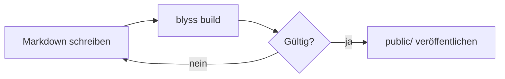

## Formeln

Eine Formel ist LaTeX zwischen Dollarzeichen. Im Text steht auf jeder Seite ein Dollarzeichen, wie in $e^{i\pi} + 1 = 0$. Eine Formel auf eigenen Zeilen steht zwischen je zwei Dollarzeichen:

$$
x = \frac{-b \pm \sqrt{b^2 - 4ac}}{2a}
$$

Blyss wandelt jede Formel beim Erstellen der Website in MathML um, das Browser ohne Skript anzeigen. Ist eine Formel kein gültiges LaTeX, bricht Blyss ab und nennt sie.

Auf das erste Dollarzeichen einer Formel folgt kein Leerzeichen, vor dem zweiten steht keines, und auf das zweite folgt keine Ziffer; Preise wie 5 $ und 10 $ oder `$5 and $10` bleiben deshalb Text. Schreiben Sie `\$` für jedes andere Dollarzeichen, das keine Formel beginnt. Dollarzeichen in Code bleiben Text; eine Formel endet vor einem Codeabschnitt und wird in einer Bildbeschreibung nicht gerendert. Auch `$$…$$` innerhalb eines Textes wird unterstützt. [Temml](https://temml.org/docs/en/supported.html) listet das unterstützte LaTeX auf.

Formeln funktionieren auch in Komponententexten, Fragmenten und Texten der Bereiche. Die lokalen Temml-Dateien des Starters müssen zur installierten Version passen; siehe [Gestaltung und Schriften](/de/book/vorlagen/#gestaltung-und-schriften).

## Fußnoten

Eine Fußnote hat einen Namen in eckigen Klammern hinter einem Zirkumflex[^name], und ihr Text folgt diesem Namen und einem Doppelpunkt auf einer eigenen Zeile, irgendwo in der Datei. Blyss nummeriert die Fußnoten in der Reihenfolge ihrer ersten Verweise[^reihenfolge] und listet sie unter dem Text auf, jede mit einem Link zurück.

[^name]: Diese Fußnote ist als `[^name]: Diese Fußnote …` geschrieben. Ihr Name kann ein Wort oder eine Zahl sein.
[^reihenfolge]: Die Namen spielen für die Nummern keine Rolle, und auf eine Fußnote können mehrere Stellen verweisen.

    Ein weiterer Absatz einer Fußnote ist um vier Leerzeichen eingerückt.

Seiten, Beiträge und Dokumente haben Fußnoten; die Texte der Komponenten, des Heros und des Overlays haben keine.

Namen enthalten keine Leerzeichen. Eine Definition ohne Verweis entfällt; ein Verweis ohne Definition sowie ein Verweis in einem Linktext oder einer Bildbeschreibung bleibt unverändert. Die Labels `footnotes` und `backToText` stellen die Beschriftungen für Screenreader bereit.

## Code

Ein mit drei Backticks eingefasster Codeblock, der seine Sprache nennt, wird beim Erstellen hervorgehoben:

```js
// Grüßt mit Namen.
const greet = name => `Hallo, ${name}!`;
console.log(greet("Blyss"));
```

Ein Block ohne Sprache oder in einer, die der Hervorheber nicht kennt, bleibt schlicht.

`static/assets/css/main.css` färbt im Starter die `hljs-…`-Klassen. Erhalten Sie beim Ändern der Farben einen Kontrast von mindestens 4,5:1 zum Codehintergrund.

## Diagramme

Ein Codeblock in der Sprache einer Diagramm-Komponente zeigt statt seines Codes das Diagramm. Der Browser zeichnet es, sobald es in die Nähe des Fensters kommt, mit einer Bibliothek, die er dann lädt; bis dahin und ohne JavaScript ist der Code zu sehen.

### Mermaid

Die Sprache `mermaid` zeigt ein Diagramm von [Mermaid](https://mermaid.js.org/):



### Flussdiagramme

Die Sprachen `flowchart` und `flow` zeigen ein Flussdiagramm von [flowchart.js](https://flowchart.js.org/):

```flowchart
start=>start: Start
write=>operation: Markdown schreiben
check=>condition: Lässt es sich erstellen?
fix=>operation: Meldung lesen
publish=>end: Veröffentlichen

start->write->check
check(yes)->publish
check(no)->fix->write
```

### Grafiken

Die Sprache `vega-lite` zeigt eine Grafik von [Vega-Lite](https://vega.github.io/vega-lite/) aus ihrer Spezifikation in JSON:

```vega-lite
{
  "description": "Beiträge pro Monat als Balken",
  "width": "container",
  "height": 160,
  "data": {
    "values": [
      { "month": "Aug", "posts": 2 },
      { "month": "Sep", "posts": 5 },
      { "month": "Okt", "posts": 3 },
      { "month": "Nov", "posts": 7 }
    ]
  },
  "mark": "bar",
  "encoding": {
    "x": { "field": "month", "type": "nominal", "sort": null, "title": "Monat", "axis": { "labelAngle": 0 } },
    "y": { "field": "posts", "type": "quantitative", "title": "Beiträge" }
  }
}
```

### Einstellungen

`components.componentMermaid`, `components.componentFlowchart` und `components.componentVegaLite` in `blyss.config.js` enthalten die Einstellungen der Diagramme, darunter die URLs ihrer Bibliotheken. Ein Block der Komponente gibt einem einzelnen Diagramm einen eigenen Titel und eigene Einstellungen: Sein Front Matter enthält sie, und der Code folgt darauf.
