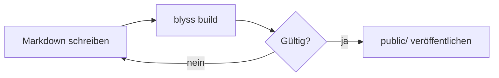

Über reines Markdown hinaus rendert Blyss hervorgehobenen Code, Formeln, Diagramme, Hinweisboxen und Abbildungen sowie Fußnoten.


## Code

Ein mit drei Backticks eingefasster Codeblock, der seine Sprache nennt, wird beim Erstellen hervorgehoben:

```js
// Grüßt mit Namen.
const greet = name => `Hallo, ${name}!`;
console.log(greet("Blyss"));
```

Ein Block ohne Sprache oder in einer, die der Hervorheber nicht kennt, bleibt schlicht.

`static/assets/css/main.css` färbt im Starter die `hljs-…`-Klassen. Erhalten Sie beim Ändern der Farben einen Kontrast von mindestens 4,5:1 zum Codehintergrund.


## Formeln

Eine Formel ist LaTeX zwischen Dollarzeichen. Im Text steht auf jeder Seite ein Dollarzeichen, wie in $e^{i\pi} + 1 = 0$. Eine Formel auf eigenen Zeilen steht zwischen je zwei Dollarzeichen:

$$
x = \frac{-b \pm \sqrt{b^2 - 4ac}}{2a}
$$

Blyss wandelt jede Formel beim Erstellen der Website in MathML um, das Browser ohne Skript anzeigen. Ist eine Formel kein gültiges LaTeX, bricht Blyss ab und nennt sie.

Auf das erste Dollarzeichen einer Formel folgt kein Leerzeichen, vor dem zweiten steht keines, und auf das zweite folgt keine Ziffer; Preise wie 5 $ und 10 $ oder `$5 and $10` bleiben deshalb Text. Schreiben Sie `\$` für jedes andere Dollarzeichen, das keine Formel beginnt. Dollarzeichen in Code bleiben Text; eine Formel endet vor einem Codeabschnitt und wird in einer Bildbeschreibung nicht gerendert. Auch `$$…$$` innerhalb eines Textes wird unterstützt. [Temml](https://temml.org/docs/en/supported.html) listet das unterstützte LaTeX auf.

Wie in [MyST](https://mystmd.org/guide/math) kommt eine Formel auch ohne Dollarzeichen aus, was sich für Texte über Preise eignet:

- Im Text steht `{math}` vor dem LaTeX in Backticks: `` {math}`a^2 + b^2 = c^2` `` ergibt {math}`a^2 + b^2 = c^2`.
- Auf eigenen Zeilen ist eine Formel der Inhalt einer `{math}`-[Direktive](#direktiven):

````markdown
```{math}
\int_0^1 x^2 \, dx = \frac{1}{3}
```
````

```{math}
\int_0^1 x^2 \, dx = \frac{1}{3}
```

Eine Formel auf eigenen Zeilen kann ein Label und eine Nummer haben; siehe [Labels und Nummern](/de/book/schreiben/labels-nummern-referenzen/#formeln).

Formeln funktionieren auch in Komponententexten, Fragmenten und Texten der Bereiche. Die lokalen Temml-Dateien des Starters müssen zur installierten Version passen; siehe [Gestaltung und Schriften](/de/book/vorlagen/#gestaltung-und-schriften).


## Diagramme

Ein Codeblock in der Sprache einer Diagramm-Komponente zeigt statt seines Codes das Diagramm. Der Browser zeichnet es, sobald es in die Nähe des Fensters kommt, mit einer Bibliothek, die er dann lädt; bis dahin und ohne JavaScript ist der Code zu sehen.


### Mermaid

Die Sprache `mermaid` zeigt ein Diagramm von [Mermaid](https://mermaid.js.org/):



### Flussdiagramme

Die Sprachen `flowchart` und `flow` zeigen ein Flussdiagramm von [flowchart.js](https://flowchart.js.org/):

```flowchart
start=>start: Start
write=>operation: Markdown schreiben
check=>condition: Lässt es sich erstellen?
fix=>operation: Meldung lesen
publish=>end: Veröffentlichen

start->write->check
check(yes)->publish
check(no)->fix->write
```

### Grafiken

Die Sprache `vega-lite` zeigt eine Grafik von [Vega-Lite](https://vega.github.io/vega-lite/) aus ihrer Spezifikation in JSON:

```vega-lite
{
  "description": "Beiträge pro Monat als Balken",
  "width": "container",
  "height": 160,
  "data": {
    "values": [
      { "month": "Aug", "posts": 2 },
      { "month": "Sep", "posts": 5 },
      { "month": "Okt", "posts": 3 },
      { "month": "Nov", "posts": 7 }
    ]
  },
  "mark": "bar",
  "encoding": {
    "x": { "field": "month", "type": "nominal", "sort": null, "title": "Monat", "axis": { "labelAngle": 0 } },
    "y": { "field": "posts", "type": "quantitative", "title": "Beiträge" }
  }
}
```

### Einstellungen

`components.componentMermaid`, `components.componentFlowchart` und `components.componentVegaLite` in `blyss.config.js` enthalten die Einstellungen der Diagramme, darunter die URLs ihrer Bibliotheken. Ein Block der Komponente gibt einem einzelnen Diagramm einen eigenen Titel und eigene Einstellungen: Sein Front Matter enthält sie, und der Code folgt darauf.


## Hinweisboxen

Eine Hinweisbox hebt eine Anmerkung oder eine Warnung vom umgebenden Text ab. Wie in [MyST](https://mystmd.org/guide/admonitions) ist sie eine [Direktive](#direktiven) mit dem Namen ihrer Art:

````markdown
```{note}
Erstellen Sie die Website, bevor Sie sie ausliefern.
```
````

```{note}
Erstellen Sie die Website, bevor Sie sie ausliefern.
```

Die zehn Arten teilen sich vier Farben:

- `note` und `important` informieren.
- `hint`, `seealso` und `tip` raten.
- `attention`, `caution` und `warning` mahnen zur Vorsicht.
- `danger` und `error` warnen vor Schaden.

Ihren Titel nimmt eine Hinweisbox aus dem ersten davon, das sie hat:

1. Der Text hinter ihrer Art, der Markdown enthalten kann.
2. Ihr erster Block, falls er eine Überschrift oder ein vollständig fett gesetzter Absatz ist.
3. Das Label ihrer Art in der Sprache der Seite, etwa `note: "Anmerkung"` in `blyss.config.js`.

Eine Hinweisbox ohne eigene Zeilen zeigt den Text hinter ihrer Art als ihren Text. Zwischen Doppelpunkten enthält eine Hinweisbox einen Codeblock ohne längere Begrenzung:

````markdown
:::{warning} `public/` wird neu erstellt
Jeder Build löscht dieses Verzeichnis und legt es neu an:

```bash
npm run build
```
:::
````

:::{warning} `public/` wird neu erstellt
Jeder Build löscht dieses Verzeichnis und legt es neu an:

```bash
npm run build
```
:::

Eine Hinweisbox hat drei weitere Formen:

- **Aufklappbar**: Die Klasse `dropdown` macht eine Hinweisbox aufklappbar; ein Klick auf ihren Titel öffnet sie. Die Option `open` zeigt sie von Anfang an geöffnet.
- **`{admonition}`**: eine Hinweisbox ohne eigene Art. Sie hat den Titel, den sie erhält, oder keinen, und die Farbe der Art, die eine ihrer Klassen nennt.
- **Alerts**: Wie auf GitHub ist ein Zitat, das mit `[!NOTE]`, `[!TIP]`, `[!IMPORTANT]`, `[!WARNING]` oder `[!CAUTION]` beginnt, eine Hinweisbox dieser Art. Jede seiner Zeilen beginnt mit `>`.

````markdown
:::{admonition} Warum liegt `public/` nicht in Git?
:class: dropdown tip
Es ist generierte Ausgabe: Jeder Build legt es neu an.
:::

> [!IMPORTANT]
> Ersetzen Sie die Platzhalterwerte, bevor Sie veröffentlichen.
````

:::{admonition} Warum liegt `public/` nicht in Git?
:class: dropdown tip
Es ist generierte Ausgabe: Jeder Build legt es neu an.
:::

> [!IMPORTANT]
> Ersetzen Sie die Platzhalterwerte, bevor Sie veröffentlichen.

Eine Hinweisbox ist ein `div` mit den Klassen `admonition` und ihrer Art, ihr Titel ein Absatz mit der Klasse `admonition-title`; eine aufklappbare ist ein `details` mit ihrem Titel als `summary`. `static/assets/css/main.css` gestaltet sie im Starter, und jede weitere Klasse der Option `class` können Sie selbst gestalten. Die Option `label` benennt eine Hinweisbox; siehe [Labels und Nummern](/de/book/schreiben/labels-nummern-referenzen/#labels).


## Aufgabenlisten

Ein Listenpunkt, der mit `[ ]` oder `[x]` beginnt, zeigt ein Kontrollkästchen, wie auf GitHub und in Editoren wie MarkText:

```markdown
- [x] Text schreiben
- [ ] Abbildung ergänzen
- [ ] Veröffentlichen
```

- [x] Text schreiben
- [ ] Abbildung ergänzen
- [ ] Veröffentlichen

Ein Kontrollkästchen zeigt, was im Markdown steht; Lesende können es nicht ankreuzen.


## Bilder und Abbildungen

`` zeigt ein Bild im Text. Wie in [MyST](https://mystmd.org/guide/figures) zeigen zwei [Direktiven](#direktiven) ein Bild auf eigenen Zeilen, jeweils mit der URL des Bildes hinter ihrem Namen:

- `{image}` zeigt das Bild allein.
- `{figure}` zeigt es mit einer Bildunterschrift, dem Inhalt der Direktive.

````markdown
```{figure} /assets/img/gallery/lighthouse.svg
:alt: Ein Leuchtturm vor einem orangefarbenen Himmel
:width: 30%
:align: center

Ein Leuchtturm aus der **Galerie** des Starters.
```
````

```{figure} /assets/img/gallery/lighthouse.svg
:alt: Ein Leuchtturm vor einem orangefarbenen Himmel
:width: 30%
:align: center

Ein Leuchtturm aus der **Galerie** des Starters.
```

Beide haben diese Optionen:

- `alt`: die Beschreibung des Bildes für alle, die es nicht sehen können.
- `width`: eine Zahl mit einer CSS-Einheit, etwa `30%` der Textbreite oder `300px`; eine Zahl allein zählt in Pixeln. Das Stylesheet des Starters hält ein Bild innerhalb der Textbreite.
- `align`: `left`, `center` oder `right`. Ohne diese Option steht das Bild wie der Text um es herum.
- `label` und, für eine Abbildung, `enumerated`: Sie benennen und nummerieren sie; siehe [Labels und Nummern](/de/book/schreiben/labels-nummern-referenzen/#abbildungen).

Ein ausgerichtetes Bild trägt die Klasse `align-left`, `align-center` oder `align-right` an seinem Absatz oder an seinem `figure`, nach der das Stylesheet es platziert.

Eine Abbildung ohne URL zeigt die Bilder ihres Inhalts nebeneinander, jedes mit einem Buchstaben und seiner Beschreibung darunter. Der Rest ihres Inhalts ist die gemeinsame Bildunterschrift:

````markdown
:::{figure}


Zwei Bilder der Galerie.
:::
````

:::{figure}


Zwei Bilder der Galerie.
:::


## Direktiven

Hinweisboxen, `{image}`, `{figure}` und `{math}` sind Direktiven von [MyST](https://mystmd.org/guide/syntax-overview), und die einzigen, die Blyss liest. Sie haben dieselbe Form:

- **Name**: Die öffnende Zeile nennt die Direktive in geschweiften Klammern. Der Text hinter dem Namen ist ihr Argument, etwa ein Titel oder eine URL.
- **Begrenzung**: Eine Direktive steht zwischen zwei Zeilen aus mindestens drei Backticks oder aus mindestens drei Doppelpunkten; beides bedeutet dasselbe. Doppelpunkte eignen sich für einen Inhalt aus Markdown, etwa den einer Hinweisbox: Andere Werkzeuge wie GitHub zeigen ihn dann als Text statt als Code. Backticks eignen sich für eine Formel.
- **Verschachtelung**: Die schließende Zeile ist mindestens so lang wie die öffnende. Eine Direktive enthält deshalb eine Direktive oder einen Codeblock mit kürzerer Begrenzung oder mit der anderen Art von Begrenzung.
- **Optionen**: Sie folgen unmittelbar auf die öffnende Zeile, als Zeilen der Form `:key: value` oder, wie im Block einer Komponente, als Zeilen der Form `key: value` zwischen zwei Zeilen aus `---`. Eine Textzeile, die wie eine Option beginnt, folgt auf eine Leerzeile.
- **Strenge**: Eine Option, die Blyss nicht kennt, etwa `icon` einer Hinweisbox aus MyST, stoppt den Build mit einer Meldung, die die Datei nennt. Dasselbe gilt für ein Bild ohne URL und für ein ungültiges `width` oder `align`.
- **Andere Namen**: Eine Begrenzung mit einem anderen Namen in geschweiften Klammern bleibt, was sie in Markdown ist: ein Codeblock zwischen Backticks und Text zwischen Doppelpunkten.

Direktiven funktionieren in jedem Markdown-Text, auch in einer Liste, einem Zitat oder einer anderen Direktive. In einer Direktive bleibt, wie in einer Liste, ein Diagramm oder der [Block einer Komponente](/de/book/komponenten/#blöcke-pro-verwendung), den doppelte geschweifte Klammern benennen, Code.


## Fußnoten

Eine Fußnote hat einen Namen in eckigen Klammern hinter einem Zirkumflex[^name], und ihr Text folgt diesem Namen und einem Doppelpunkt auf einer eigenen Zeile, irgendwo in der Datei. Blyss nummeriert die Fußnoten in der Reihenfolge ihrer ersten Verweise[^reihenfolge] und listet sie unter dem Text auf, jede mit einem Link zurück.

[^name]: Diese Fußnote ist als `[^name]: Diese Fußnote …` geschrieben. Ihr Name kann ein Wort oder eine Zahl sein.
[^reihenfolge]: Die Namen spielen für die Nummern keine Rolle, und auf eine Fußnote können mehrere Stellen verweisen.

    Ein weiterer Absatz einer Fußnote ist um vier Leerzeichen eingerückt.

Seiten, Beiträge und Dokumente haben Fußnoten; die Texte der Komponenten, des Heros und des Overlays haben keine.

Namen enthalten keine Leerzeichen. Eine Definition ohne Verweis entfällt; ein Verweis ohne Definition sowie ein Verweis in einem Linktext oder einer Bildbeschreibung bleibt unverändert. Die Labels `footnotes` und `backToText` stellen die Beschriftungen für Screenreader bereit.
