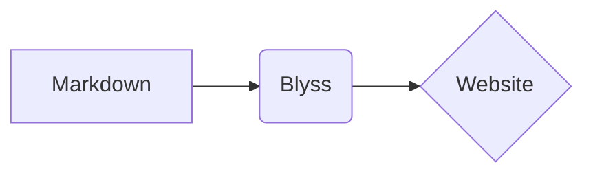

Ihr Text bleibt in Ihrem Browser. **Unterstützt:** Markdown, hervorgehobener Code, Formeln, Hinweisboxen, Abbildungen, Fußnoten, Referenzen und Mermaid-Diagramme. **Nicht unterstützt:** andere Komponenten und Front Matter.

### Text

```markdown
## Small source

Schreiben Sie **Markdown**, erhalten Sie eine *Website*.

- [x] Lokal kreieren
- [ ] Publizieren, wenn es passt
```

### Hinweisboxen

````markdown
> [!TIP]
> Alerts funktionieren wie auf GitHub.

```{note} Auch Direktiven
Hinweisboxen folgen **MyST**.
```
````

### Code

````markdown
Von Blyss hervorgehoben:

```js
const greet = name => `Hallo, ${name}!`;
console.log(greet("Blyss"));
```
````

### Formeln

```markdown
Euler schrieb $e^{i\pi} + 1 = 0$.

$$
\int_0^1 x^2 \, dx = \frac{1}{3}
$$ (eq-flaeche)

Formel [](#eq-flaeche) hat eine Nummer.
```

### Diagramm

````markdown

````
