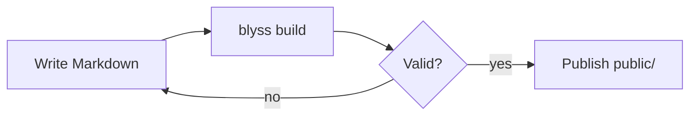

## Formulas

A formula is LaTeX between dollar signs. Within a text, one dollar sign stands on each side, as in $e^{i\pi} + 1 = 0$. A formula on lines of its own stands between two dollar signs on each side:

$$
x = \frac{-b \pm \sqrt{b^2 - 4ac}}{2a}
$$

Blyss turns each formula into MathML during the build, which browsers show without a script. The build stops and names a formula that is not valid LaTeX.

No space follows the first dollar sign of a formula and none precedes its second one, so prices such as $5 and $10 stay text. Write `\$` for any other dollar sign that starts no formula.

## Footnotes

A footnote has a name in square brackets after a caret[^name], and its text follows that name and a colon on a line of its own, anywhere in the file. Blyss numbers the footnotes in the order of their first references[^order] and lists them below the text, each with a link back.

[^name]: This footnote is written as `[^name]: This footnote …`. Its name can be a word or a number.
[^order]: The names do not matter for the numbers, and a footnote can be referred to several times.

    A further paragraph of a footnote is indented by four spaces.

Pages, posts and docs have footnotes; the texts of the components, of the hero and of the overlay have none.

## Code

A fenced code block that names its language is highlighted during the build:

```js
// Greets by name.
const greet = name => `Hello, ${name}!`;
console.log(greet("Blyss"));
```

A block without a language, or in one that the highlighter does not know, stays plain.

## Diagrams

A fenced code block in the language of a diagram component shows that diagram instead of its code. The browser draws it once it comes near the window, with a library that it loads then; until that moment, and without JavaScript, the code is shown.

### Mermaid

The language `mermaid` shows a [Mermaid](https://mermaid.js.org/) diagram:



### Flowcharts

The languages `flowchart` and `flow` show a [flowchart.js](https://flowchart.js.org/) flowchart:

```flowchart
start=>start: Start
write=>operation: Write Markdown
check=>condition: Does it build?
fix=>operation: Read the message
publish=>end: Publish

start->write->check
check(yes)->publish
check(no)->fix->write
```

### Charts

The language `vega-lite` shows a [Vega-Lite](https://vega.github.io/vega-lite/) chart from its specification in JSON:

```vega-lite
{
  "description": "Posts per month as bars",
  "width": "container",
  "height": 160,
  "data": {
    "values": [
      { "month": "Aug", "posts": 2 },
      { "month": "Sep", "posts": 5 },
      { "month": "Oct", "posts": 3 },
      { "month": "Nov", "posts": 7 }
    ]
  },
  "mark": "bar",
  "encoding": {
    "x": { "field": "month", "type": "nominal", "sort": null, "title": "Month", "axis": { "labelAngle": 0 } },
    "y": { "field": "posts", "type": "quantitative", "title": "Posts" }
  }
}
```

### Settings

`components.componentMermaid`, `components.componentFlowchart` and `components.componentVegaLite` in `blyss.config.js` hold the settings of the diagrams, among them the URLs of their libraries. A block of the component gives a single diagram a title and settings of its own: its front matter holds them, and the code follows it.
