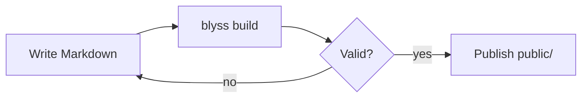

Beyond plain Markdown, Blyss renders formulae, diagrams, callouts and figures as well as highlighted code and footnotes.


## Formulae

A formula is LaTeX between dollar signs. Within a text, one dollar sign stands on each side, as in $e^{i\pi} + 1 = 0$. A formula on lines of its own stands between two dollar signs on each side:

$$
x = \frac{-b \pm \sqrt{b^2 - 4ac}}{2a}
$$

Blyss turns each formula into MathML during the build, which browsers show without a script. The build stops and names a formula that is not valid LaTeX.

No space follows the first dollar sign of a formula, none precedes its second one, and no digit follows that one, so prices such as $5 and $10 stay text. Write `\$` for any other dollar sign that starts no formula. Dollar signs in code remain text; a formula ends before a code span and is not rendered in an image description. Inline `$$…$$` is also supported. [Temml](https://temml.org/docs/en/supported.html) lists supported LaTeX.

As in [MyST](https://mystmd.org/guide/math), a formula needs no dollar signs, which suits a text about prices:

- Within a text, `{math}` precedes the LaTeX in backticks: `` {math}`a^2 + b^2 = c^2` `` gives {math}`a^2 + b^2 = c^2`.
- On lines of its own, a formula is the body of a `{math}` [directive](#directives):

````markdown
```{math}
\int_0^1 x^2 \, dx = \frac{1}{3}
```
````

```{math}
\int_0^1 x^2 \, dx = \frac{1}{3}
```

A formula on lines of its own can have a label and a number; see [Labels and numbers](/en/book/writing/labels-numbers-references/#formulae).

Formulas also work in component texts, fragments and the cards of the regions. The starter's local Temml assets must match the installed version; see [Templates and the lean theme](/en/book/templates/#top-bar-and-fonts).


## Diagrams

A fenced code block in the language of a diagram component shows that diagram instead of its code. The browser draws it once it comes near the window, with a library that it loads then; until that moment, and without JavaScript, the code is shown.


### Mermaid

The language `mermaid` shows a [Mermaid](https://mermaid.js.org/) diagram:



### Flowcharts

The languages `flowchart` and `flow` show a [flowchart.js](https://flowchart.js.org/) flowchart:

```flowchart
start=>start: Start
write=>operation: Write Markdown
check=>condition: Does it build?
fix=>operation: Read the message
publish=>end: Publish

start->write->check
check(yes)->publish
check(no)->fix->write
```

### Complex charts

The language `vega-lite` shows a [Vega-Lite](https://vega.github.io/vega-lite/) chart from its specification in JSON. This [Seattle weather example](https://vega.github.io/vega-lite/examples/interactive_seattle_weather.html) loads a CSV from Vega-Lite: drag across the dates to filter the bars, or click a weather type to filter the points.

```vega-lite
{
  "$schema": "https://vega.github.io/schema/vega-lite/v6.json",
  "title": "Seattle Weather, 2012-2015",
  "data": {
    "url": "https://vega.github.io/vega-lite/examples/data/seattle-weather.csv"
  },
  "vconcat": [
    {
      "encoding": {
        "color": {
          "condition": {
            "param": "brush",
            "title": "Weather",
            "field": "weather",
            "type": "nominal",
            "scale": {
              "domain": ["sun", "fog", "drizzle", "rain", "snow"],
              "range": ["#e7ba52", "#a7a7a7", "#aec7e8", "#1f77b4", "#9467bd"]
            }
          },
          "value": "lightgray"
        },
        "size": {
          "title": "Precipitation",
          "field": "precipitation",
          "scale": { "domain": [-1, 50] },
          "type": "quantitative"
        },
        "x": {
          "field": "date",
          "timeUnit": "monthdate",
          "title": "Date",
          "axis": { "format": "%b" }
        },
        "y": {
          "title": "Maximum Daily Temperature (C)",
          "field": "temp_max",
          "scale": { "domain": [-5, 40] },
          "type": "quantitative"
        }
      },
      "width": 600,
      "height": 300,
      "mark": "point",
      "params": [
        { "name": "brush", "select": { "type": "interval", "encodings": ["x"] } }
      ],
      "transform": [{ "filter": { "param": "click" } }]
    },
    {
      "encoding": {
        "color": {
          "condition": {
            "param": "click",
            "field": "weather",
            "scale": {
              "domain": ["sun", "fog", "drizzle", "rain", "snow"],
              "range": ["#e7ba52", "#a7a7a7", "#aec7e8", "#1f77b4", "#9467bd"]
            }
          },
          "value": "lightgray"
        },
        "x": { "aggregate": "count" },
        "y": { "title": "Weather", "field": "weather" }
      },
      "width": 600,
      "mark": "bar",
      "params": [
        { "name": "click", "select": { "type": "point", "encodings": ["color"] } }
      ],
      "transform": [{ "filter": { "param": "brush" } }]
    }
  ]
}
```


### Settings

`components.componentMermaid`, `components.componentFlowchart` and `components.componentVegaLite` in `blyss.config.js` hold the settings of the diagrams, among them the URLs of their libraries. A block of the component gives a single diagram a title and settings of its own: its front matter holds them, and the code follows it.


## Callouts

A callout sets a note or a warning apart from the text around it. As in [MyST](https://mystmd.org/guide/admonitions), it is a [directive](#directives) with the name of its kind:

````markdown
```{note}
Build the website before you serve it.
```
````

```{note}
Build the website before you serve it.
```

The ten kinds share four colours:

- `note` and `important` inform.
- `hint`, `seealso` and `tip` advise.
- `attention`, `caution` and `warning` caution.
- `danger` and `error` warn of harm.

A callout takes its title from the first of these that it has:

1. The text after its kind, which can hold Markdown.
2. Its first block, if that is a heading or a paragraph that is bold as a whole.
3. The label of its kind in the language of the page, such as `note: "Note"` in `blyss.config.js`.

A callout without lines of its own shows the text after its kind as its text. Between colons, a callout holds a code block without a longer fence:

````markdown
:::{warning} `public/` is rebuilt
Every build deletes and recreates this directory:

```bash
npm run build
```
:::
````

:::{warning} `public/` is rebuilt
Every build deletes and recreates this directory:

```bash
npm run build
```
:::

A callout has three further forms:

- **Dropdown**: the class `dropdown` makes a callout one that opens at a click on its title. The option `open` shows it open from the start.
- **`{admonition}`**: a callout without a kind of its own. It has the title that it is given, or none, and the colour of the kind that one of its classes names.
- **Alerts**: as on GitHub, a quotation that starts with `[!NOTE]`, `[!TIP]`, `[!IMPORTANT]`, `[!WARNING]` or `[!CAUTION]` is a callout of that kind. Each of its lines starts with `>`.

````markdown
:::{admonition} Why is `public/` not in Git?
:class: dropdown tip
It is generated output: every build recreates it.
:::

> [!IMPORTANT]
> Replace the placeholder values before you publish.
````

:::{admonition} Why is `public/` not in Git?
:class: dropdown tip
It is generated output: every build recreates it.
:::

> [!IMPORTANT]
> Replace the placeholder values before you publish.

A callout is a `div` with the classes `admonition` and its kind, and its title a paragraph with the class `admonition-title`; a dropdown is a `details` with its title as its `summary`. The starter's `static/assets/css/main.css` styles them, and any further class of the option `class` is yours to style. The option `label` names a callout; see [Labels and numbers](/en/book/writing/labels-numbers-references/#labels).


## Images and figures

`` shows an image within a text. As in [MyST](https://mystmd.org/guide/figures), two [directives](#directives) show an image on lines of its own, each with the URL of the image after its name:

- `{image}` shows the image alone.
- `{figure}` shows it with a caption, the body of the directive.

````markdown
```{figure} /assets/img/gallery/lighthouse.svg
:alt: A lighthouse in front of an orange sky
:width: 30%
:align: center

A lighthouse from the **gallery** of the starter.
```
````

```{figure} /assets/img/gallery/lighthouse.svg
:alt: A lighthouse in front of an orange sky
:width: 30%
:align: center

A lighthouse from the **gallery** of the starter.
```

Both have these options:

- `alt`: the description of the image for readers who cannot see it.
- `width`: a number with a unit of CSS, such as `30%` of the width of the text or `300px`; a number alone counts in pixels. The starter's stylesheet keeps an image within the width of the text.
- `align`: `left`, `center` or `right`. Without it, the image stands like the text around it.
- `label`, and `enumerated` for a figure: they name and number it; see [Labels and numbers](/en/book/writing/labels-numbers-references/#figures).

An aligned image has the class `align-left`, `align-center` or `align-right` on its paragraph or on its `figure`, by which the stylesheet places it.

A figure without a URL shows the images of its body side by side, each with a letter and its description below it. The rest of its body is the caption of them all:

````markdown
:::{figure}


Two images of the gallery.
:::
````

:::{figure}


Two images of the gallery.
:::


## Turns of humans and agents

A text that a human and an AI agent write together shows who wrote what: each turn is a `{contribution}`, attributed to its author and dated.

````markdown
:::{contribution}
:by: human
:author: Ada
:date: 2026-11-26
Which static site generator suits a small multilingual website?
:::

:::{contribution}
:by: agent
:author: Claude
:date: 2026-11-27
One that keeps each language in Markdown files of its own.
:::
````

:::{contribution}
:by: human
:author: Ada
:date: 2026-11-26
Which static site generator suits a small multilingual website?
:::

:::{contribution}
:by: agent
:author: Claude
:date: 2026-11-27
One that keeps each language in Markdown files of its own.
:::

- `:by:` is required: `human` or `agent`. The labels `contributionHuman` and `contributionAgent` of the language name the kind.
- `:author:` names the author and `:date:` dates the turn, as in `2026-11-26`.
- A label, `(name)=` on the line above, lets another turn link to it.
- The JSON-LD of the page names the authors as its `contributor`: a human as a `Person`, an agent as a `SoftwareApplication`. A human without a name is the publisher of the website.

The file `AGENTS.md` of the website tells an agent to add its turns below the last one and never to change another.

## Directives

Callouts, `{image}`, `{figure}` and `{math}` are directives of [MyST](https://mystmd.org/guide/syntax-overview), and, with Blyss's own [`{contribution}`](#turns-of-humans-and-agents), the only ones that Blyss reads. They share one form:

- **Name**: the opening fence names the directive in braces. The text after the name is its argument, such as a title or a URL.
- **Fences**: a directive stands between two lines of at least three backticks or of at least three colons, which mean the same. Colons suit a body of Markdown, such as that of a callout: another tool, such as GitHub, then shows the body as text rather than as code. Backticks suit a formula.
- **Nesting**: the closing fence is at least as long as the opening one. A directive therefore holds a directive or a code block with a shorter fence, or with the other kind of fence.
- **Options**: they follow the opening fence at once, as lines of `:key: value` or, as in the block of a component, as lines of `key: value` between two lines of `---`. A line of text that starts like an option follows an empty line.
- **Strictness**: an option that Blyss does not know, such as the `icon` of a callout in MyST, stops the build with a message that names the file. So do an image without a URL and a `width` or an `align` that is not valid.
- **Other names**: a fence with any other name in braces stays what it is in Markdown, a code block between backticks and text between colons.

Directives work in every Markdown text, also within a list, a quotation or another directive. Within a directive, as within a list, a diagram or the [block of a component](/en/book/components/#blocks), which double braces name, remains code.


## Code

A fenced code block that names its language is highlighted during the build:

```js
// Greets by name.
const greet = name => `Hello, ${name}!`;
console.log(greet("Blyss"));
```

A block without a language, or in one that the highlighter does not know, stays plain.

The starter's `static/assets/css/main.css` colours the `hljs-…` classes; preserve a contrast of at least 4.5:1 against the code background when changing them.


## Task lists

A list item that starts with `[ ]` or `[x]` shows a checkbox, as on GitHub and in editors such as MarkText:

```markdown
- [x] Write the text
- [ ] Add a figure
- [ ] Publish
```

- [x] Write the text
- [ ] Add a figure
- [ ] Publish

A checkbox shows what the Markdown says; a reader cannot tick it.


## Footnotes

A footnote has a name in square brackets after a caret[^name], and its text follows that name and a colon on a line of its own, anywhere in the file. Blyss numbers the footnotes in the order of their first references[^order] and lists them below the text, each with a link back.

[^name]: This footnote is written as `[^name]: This footnote …`. Its name can be a word or a number.
[^order]: The names do not matter for the numbers, and a footnote can be referred to several times.

    A further paragraph of a footnote is indented by four spaces.

Pages, posts and docs have footnotes; the texts of the components, of the hero and of the overlay have none.

Names contain no spaces. An unreferenced definition is omitted; an undefined reference, or one in link text or an image description, stays as written. The `footnotes` and `backToText` labels provide screen-reader text.
